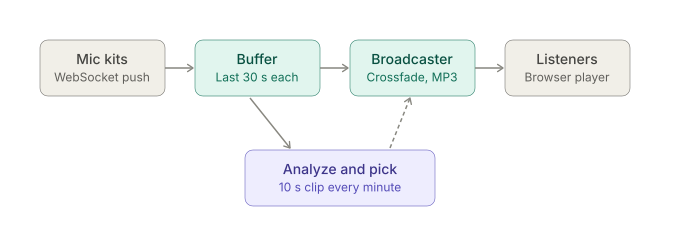

# Nature Sound

Live nature-sound streaming. Microphone kits in forests push audio to this server; every
minute the server analyses the last 10 s of each source for unwanted
sound (wind, clipping, mains hum, bumps, voice-like modulation, dead mic) and broadcasts the
cleanest one, crossfading on switches.



Solid arrows carry audio; the dashed arrow carries the decision of which source to play.

- `GET /` – public site with the live player
- `GET /listen` – the live MP3 stream
- `GET /admin.html` – admin page: kit status and maintenance toggles (needs `TOKEN` to change anything)
- `PUT /admin/sources/<id>/maintenance` – operator API (see below)
- `GET /status` (per-source scores and flags as JSON), `GET /health`
- `WS /ingest/<id>` – kits connect here. Binary frames carry the encoded stream (Ogg/Opus or FLAC recommended). Text frames are JSON control messages: `{"type":"power","low":true,"battery":0.12}` tells the server the kit is low on power, so it stops being chosen and the broadcast moves to another source straight away; send `"low":false` when it has recovered.

## Config

All tunables are constants in `src/config.js` (only `PORT` comes from the environment).

## Maintenance mode

To service a kit, put it in maintenance so listeners are faded over to another source and it is never
chosen until you clear it. Set `TOKEN` on the server first. Without it the endpoint is disabled.

```
curl -X PUT https://<host>/admin/sources/forest-1/maintenance \
  -H "Authorization: Bearer $TOKEN" -H "Content-Type: application/json" -d '{"value": true}'
```

Send `{"value": false}` to bring it back. `/status` shows `maintenance` for every source. The flag is kept in
memory, so a server restart clears it, and it does not stop the kit from streaming.

## Demo cubes

With `DEMO_KIT=true` the server runs two simulated cubes, `demo-1` (clean) and `demo-2` (windy), as
ordinary sources. They show up on the admin page marked "(demo)", get scored, and can be put in
maintenance. By default their audio is never chosen for the live stream, so listeners never hear it.
Set `DEMO_ON_AIR=true` to let them be chosen too, which is handy for seeing a switch happen.

## Run locally

Needs Node 20+ and `ffmpeg` (with libopus and libmp3lame) on the PATH.

```
npm install
npm start
npm run simulate -- --id forest-1 --kind good
npm run simulate -- --id forest-2 --kind wind
```

Then open http://localhost:3000. `npm test` runs the unit tests (no ffmpeg needed).

## Notes

- There is no authentication: anyone who can reach the server can push audio to `/ingest/<id>` or listen. Put it behind something before real use.
- Render only exposes HTTP(S)/WebSocket, so kits must use WebSocket ingest, not RTSP/RTMP.
- Runs on a paid always-on plan; free services sleep and would drop the streams.
- The analysis is heuristic DSP. Thresholds live in `src/analysis.js` and need tuning against real recordings.
